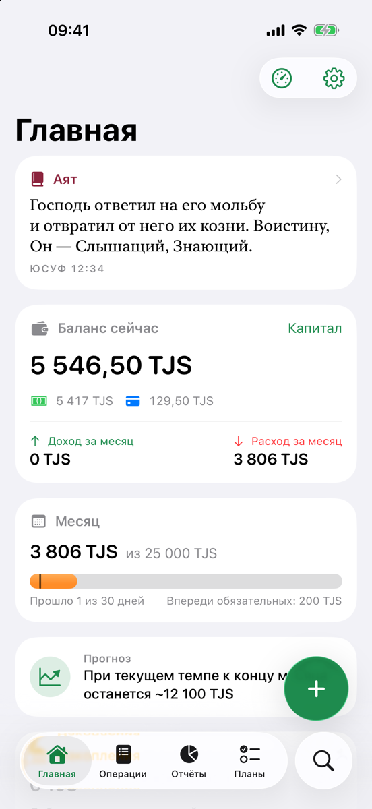
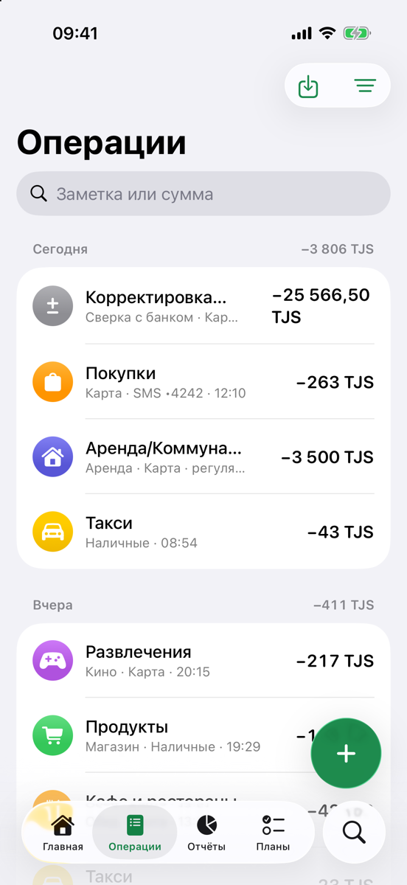
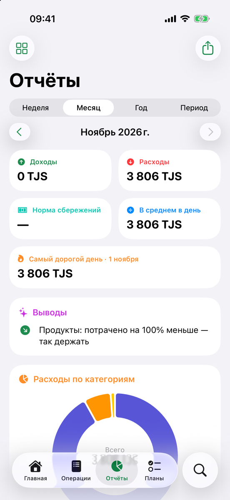
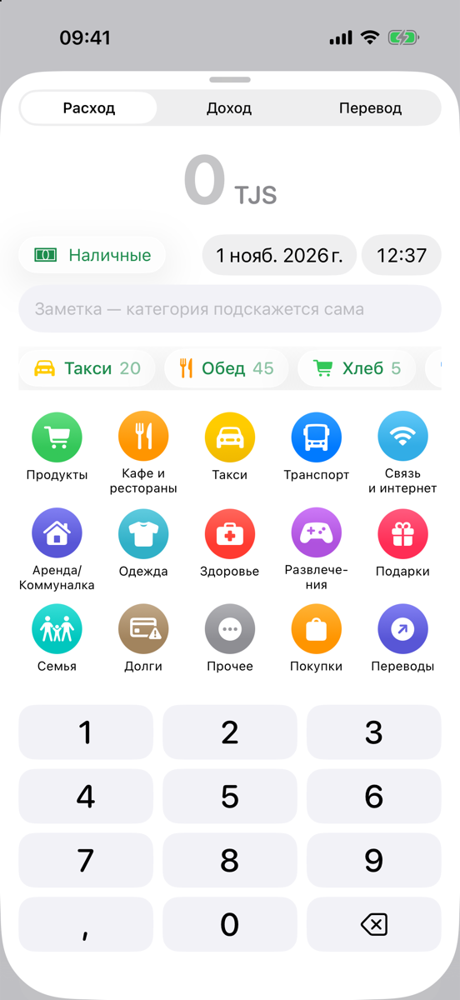

# Hisob

Personal finance and daily planner for iPhone: SMS auto-import, reports, savings, debts,
widgets and Apple Watch. Native Swift 6 / SwiftUI, no third-party libraries, no server —
all data stays on your device.

**Hisob** — «счёт» по-таджикски. **Личные финансы и планы на день для iPhone.** Интерфейс приложения на русском, валюта по умолчанию — TJS.

<p>
  
  
  
  
</p>

Screenshots use generated demo data.

## Возможности

- **Быстрое добавление:** сумма → тап по категории, шаблоны в один тап, расход, доход, перевод, отмена за 5 секунд.
- **Автоимпорт SMS банка** через приложение «Команды»: суммы, карта, магазин, остаток, защита от дублей, сверка баланса, папка «Входящие», обучение парсера на своих SMS.
- **Другие способы импорта:** «Поделиться» (текст или скриншот, распознавание на устройстве), сканер чеков, выписки CSV, Excel и PDF.
- **Отчёты:** диаграммы по категориям и дням, сравнение периодов, текстовые выводы, экспорт в PDF и CSV с итогами.
- **Учёт:** несколько счетов и валют, бюджеты, копилка и цели, долги, подписки, капитал, денежный поток, конверты, итоги месяца.
- **Планы:** задачи и встречи по дням, ввод одной строкой, напоминания.
- **Аяты:** виджет экрана блокировки «Аят по времени», перевод на русский, чтение сур, поиск, избранное.
- **Виджеты, Пункт управления, Live Activity, Apple Watch.**
- **Приватность:** Face ID, скрытие сумм, резервная копия в JSON. iCloud выключен по умолчанию.

## Требования

- Xcode 27, iOS 26 или новее
- [XcodeGen](https://github.com/yonaskolb/XcodeGen): проект генерируется из `project.yml`

## Запуск

```bash
brew install xcodegen
git clone https://github.com/HackSpecter/hisob.git
cd hisob
xcodegen generate
open MoiFinansy.xcodeproj
```

В симуляторе подпись не нужна. Тестовые данные за 3 месяца: аргумент запуска `-demoData` (только DEBUG).

```bash
./build.sh   # сборка: выводит только ошибки и предупреждения
./test.sh    # unit-тесты
```

## Установка на iPhone

1. Включите на iPhone режим разработчика: «Настройки → Конфиденциальность и безопасность → Режим разработчика».
2. Укажите свою команду Apple Developer и, если хотите, своё имя приложения:
   ```bash
   cp Config/Local.xcconfig.example Config/Local.xcconfig
   ```
3. Замените `tj.khalid.hisob` и `group.tj.khalid.hisob` на свои идентификаторы в `project.yml`, файлах `*.entitlements`, `SharedDefaults.swift`, `DataStore.swift` и `Watch/`.
4. Выполните `xcodegen generate`, выберите iPhone в Xcode и нажмите ⌘R.

С бесплатным Apple ID iCloud и push недоступны: удалите из `project.yml` ключи `com.apple.developer.icloud-*` и `aps-environment`. Такое приложение нужно переустанавливать каждые 7 дней.

## Автозапись SMS

iOS не даёт приложениям читать SMS, поэтому их передаёт автоматизация «Команд»:

1. **Команды → Автоматизация → «+» → Сообщение**. Укажите «Сообщение содержит» и последние цифры своей карты.
2. Выберите **«Выполнять сразу»**.
3. Добавьте действие **Hisob → «Обработать SMS банка»**, в поле текста выберите **«Входные данные команды»**.
4. Добавьте карту: **Настройки → SMS банков → Мои карты**.

Текст SMS приходит из «Команд» без подтверждения подлинности, поэтому чужое SMS с номером вашей карты может создать операцию или изменить баланс. Надёжнее указать в автоматизации отправителя-банк, если iOS это позволяет.

Встроенные правила банков приблизительные. Для другого формата есть «Обучить парсер».

## Структура

```
MoiFinansy/       приложение: App, Models, Services, Components, Features, Quran, Resources
Widgets/          виджеты, Live Activity, Пункт управления
ShareExtension/   «Поделиться → Добавить в Hisob»
Watch/            приложение для Apple Watch и комплекшн
MoiFinansyTests/  unit-тесты (Swift Testing)
tools/            сборка данных Корана из файлов Tanzil
```

Внутренние имена таргетов (`MoiFinansy`) исторические. Деньги считаются только в `Decimal`.

## Участие

См. [CONTRIBUTING.md](CONTRIBUTING.md). Об уязвимостях: [SECURITY.md](SECURITY.md).

## Лицензия

Код: [MIT](LICENSE). Тексты Корана, переводы и шрифты распространяются на своих условиях, переводы **только для некоммерческого использования**: см. [NOTICE.md](NOTICE.md).

Приложение не является финансовой или религиозной консультацией и не связано с банками.
